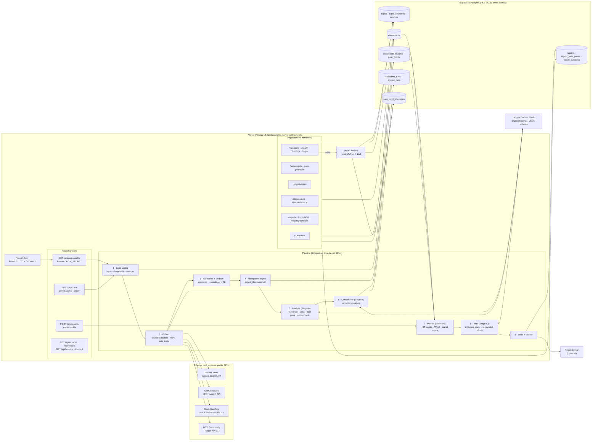
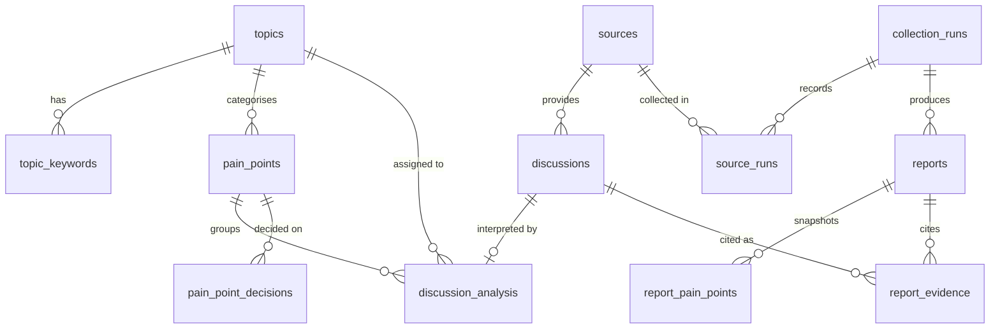

# Components Map — Developer Community Pulse

> Generated from `lib/componentsMap.ts` (the same source renders the diagram at **/architecture** in the app).
> `tests/unit/componentsMap.test.ts` fails if a table or route on this map does not exist in the code, or if this file drifts from the source.

## Legend and data flow

| # | Step | Component (code) | Reads / writes |
|---|------|------------------|----------------|
| 0 | Trigger | Vercel Cron → `GET /api/cron/weekly` (Bearer `CRON_SECRET`), or admin `POST /api/runs` | `collection_runs` (one running at a time, one cron run per week) |
| 1 | Load config | `lib/db/config.ts#getActiveConfig` | `topics`, `topic_keywords`, `sources` |
| 2 | Collect | `lib/sources/{hackernews,github,stackoverflow,devto}.ts` behind `SourceAdapter` | public APIs; `source_runs` |
| 3 | Normalise + dedupe | `lib/sources/index.ts#dedupeDiscussions`, `lib/text.ts` | — |
| 4 | Idempotent ingest | Postgres `ingest_discussions()` via `lib/db/discussions.ts` | `discussions` |
| 5 | Analyse (Gemini Flash) | `lib/ai/analyze.ts` | `discussion_analysis` |
| 6 | Consolidate (Gemini Flash) | `lib/ai/consolidate.ts` | `pain_points` |
| 7 | Metrics (code) | `lib/analytics/metrics.ts`, `lib/time/periods.ts` | reads all of the above |
| 8 | Brief (Gemini Flash) | `lib/ai/brief.ts` (evidence pack → grounded JSON) | — |
| 9 | Store + deliver | `lib/pipeline/report.ts`, `lib/email/sendBrief.ts` (Resend) | `reports`, `report_pain_points`, `report_evidence` |
| — | UI | `app/**/page.tsx` (server components), `components/*` | read-only via server |
| — | Mutations | `app/actions.ts` (Server Actions: `requireAdmin` + Zod) | `topics`, `topic_keywords`, `sources`, `discussions.is_excluded`, `pain_point_decisions` |

## Database relationships

## Security boundaries

- **Browser ↔ server:** the browser never calls Supabase or Gemini. Secrets live only in server env vars.
- **Admin boundary:** every mutation re-checks an HMAC-signed httpOnly session cookie on the server.
- **Cron boundary:** `/api/cron/weekly` requires `Authorization: Bearer CRON_SECRET`.
- **Database boundary:** RLS enabled, no policies for `anon`/`authenticated` on v2 tables; service-role key server-side only.
- **AI boundary:** external text is delimited and treated as untrusted; model output is schema-validated and can only reference keys created by code.
